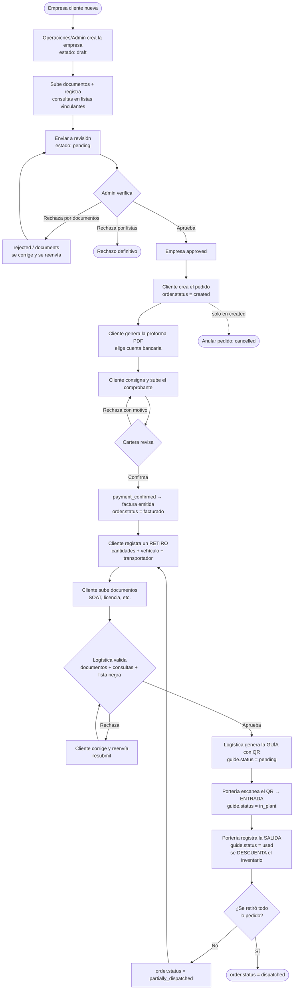
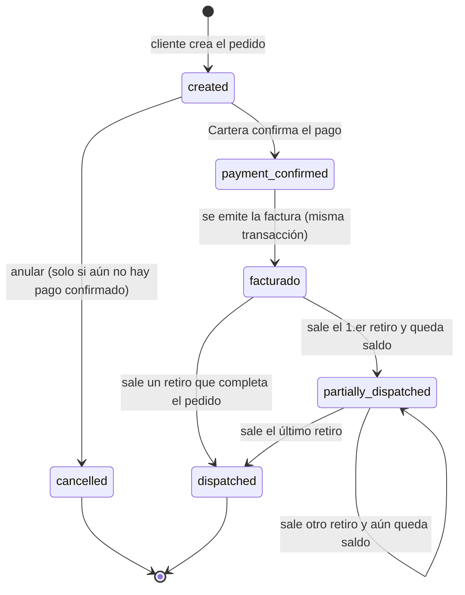
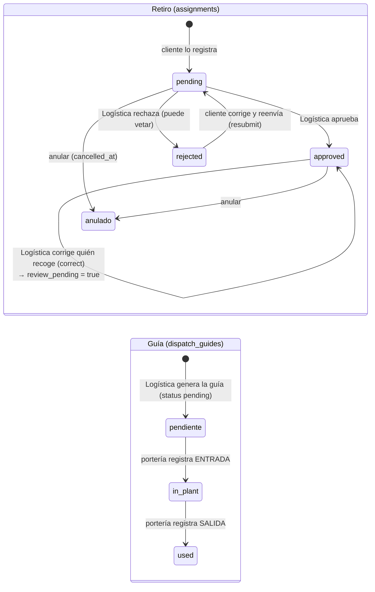
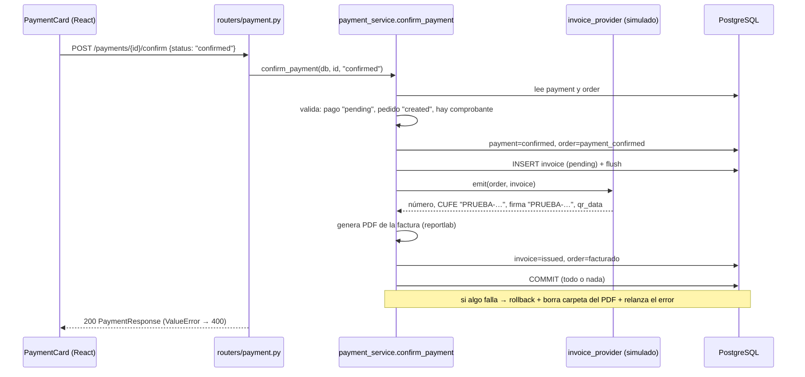
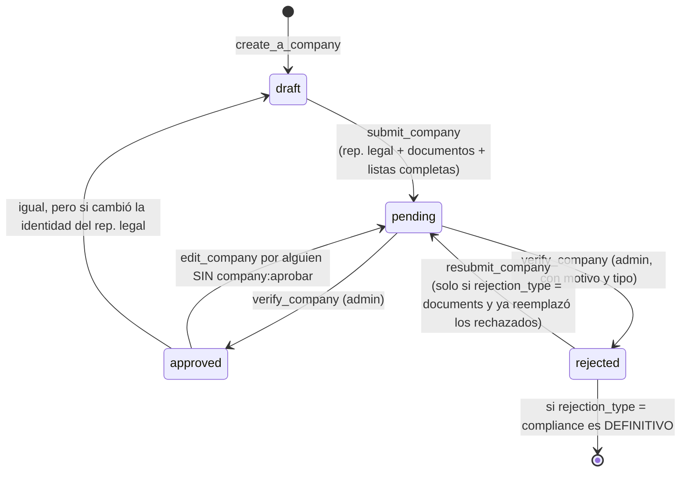

# 02 · Flujo del pedido (con diagramas)

> Los diagramas están escritos en **Mermaid**. Se ven automáticamente en GitHub y en VS Code (con la extensión
> *Markdown Preview Mermaid Support*). Debajo de cada uno hay una explicación en texto por si no se renderizan.

## 1. Visión general (de punta a punta)

**En texto:** empresa aprobada → pedido (`created`) → proforma → comprobante → Cartera confirma → factura y estado
`facturado` → uno o varios retiros (cada uno: datos de transporte → validación de Logística → guía con QR → entrada en
portería → salida en portería, que descuenta inventario) → el pedido queda `partially_dispatched` hasta que todo lo
pedido salió, y entonces `dispatched`.

## 2. Estados del **pedido** (`orders.status`)

Notas importantes:

- `payment_confirmed` es **transitorio**: dura solo lo que tarda la transacción de `confirm_payment`. En la práctica
  el pedido pasa de `created` a `facturado`. Si la emisión de la factura falla, se hace `rollback` y el pago sigue pendiente.
- Los retiros se pueden registrar y mover solo con el pedido en `facturado` o `partially_dispatched`
  (constante `WITHDRAWAL_ORDER_STATUSES` en [order_service.py](../Backend/app/services/order_service.py)).
- Solo se puede **anular** en `created` (`CANCELLABLE_STATUSES`), y solo si no hay un comprobante pendiente de revisar.
- Solo se puede **editar** en `created` y sin proforma (`edit_order`).
- ⚠️ **Contradicción documentada:** `CLAUDE.md` y el README viejo hablan de `transport_validated` y
  `dispatch_guide_generated` como estados del pedido. **Ya no existen** en el código ni en la interfaz
  ([orderStatus.js](../Frontend/src/constants/orderStatus.js) solo tiene created, payment_confirmed, facturado,
  partially_dispatched, dispatched, cancelled). Ver [06](06-pendientes-y-decisiones.md).

## 3. Estados de un **retiro** (`assignments`) y de su **guía** (`dispatch_guides`)

- Un retiro **no** tiene un campo `status` único: tiene `validation_status` (`pending|approved|rejected`) y, aparte,
  `cancelled_at` (si no es nulo, el retiro está anulado y sus cantidades quedan liberadas).
- `review_pending = true` significa que, tras haber sido aprobado, cambió el vehículo o transportador y Logística debe
  repetir las consultas (`complete_post_review`).
- Una guía solo se genera si el retiro está `approved`, no está vetado y el pedido está en `facturado/partially_dispatched`.
- Un retiro con guía `in_plant` no se puede anular (primero hay que registrar la salida); uno con guía `used` ya no se
  puede modificar.
- ℹ️ El comentario del modelo `DispatchGuide.status` dice `pending, used`; el código también usa **`in_plant`**.

## 4. Paso a paso con tabla, función y pantalla

| # | Paso | Quién | Pantalla (Frontend) | Endpoint | Función de servicio | Tablas que cambia |
|---|------|-------|---------------------|----------|--------------------|-------------------|
| 1 | Crear empresa en borrador | operaciones / soporte / admin (`company:gestionar`) | `/companies/new` (`CompanyNew`) | `POST /companies/` | `company_service.create_a_company` | `companies` (`verification_status=draft`, `client_code` CLI-NNNN) |
| 2 | Subir documentos de la empresa | `document:subir` | `CompanyNew` / `CompanyDetail` | `POST /documents/{company_id}` | `document_service.create_document` | `documents` |
| 3 | Registrar consultas en listas | `company:gestionar` | `ComplianceTable` en `CompanyNew/Detail` | `PUT /compliance-checks/company/{id}/{check_key}` | `compliance_check_service.upsert_check` | `compliance_checks` |
| 4 | Enviar a revisión | `company:gestionar` | `CompanyNew` | `PATCH /companies/{id}/submit` | `company_service.submit_company` | `companies` → `pending` |
| 5 | Aprobar / rechazar empresa | `company:aprobar` (solo admin) | `CompanyDetail` | `PATCH /companies/{id}/verify` | `company_service.verify_company` | `companies` → `approved`/`rejected` |
| 6 | Crear usuario del cliente | `user:gestionar` (admin) | solo Swagger | `POST /auth/register` | `user_service.create_user` | `users` |
| 7 | Entrar (login o magic link) | cualquiera | `/login`, `/link-login` | `POST /auth/login`, `GET /magic-links/verify/{token}` | `authenticate_user`, `verify_magic_link` | `magic_links` (si aplica) |
| 8 | **Crear pedido** | `order:crear` | `/orders/new` (`OrderNew`) | `POST /orders/` | `order_service.create_order` | `orders`, `order_items`, `order_counters` |
| 9 | (Opcional) Editar pedido | `order:crear` | `/orders/:id/edit` | `PUT /orders/{id}` | `order_service.edit_order` | `order_items` (se rehacen), `orders` |
| 10 | **Generar proforma** | `payment:crear` / `crear_propio` | `PaymentCard` | `POST /payments/` | `payment_service.create_payment` (+ `proforma_pdf.generate_proforma_pdf`) | `payments`, archivo en `uploads/proformas/` |
| 11 | Descargar proforma | quien ve el pago | `PaymentCard` (vista previa) | `GET /payments/{id}/proforma` | (router) | — |
| 12 | **Subir comprobante** | `payment:subir_comprobante` | `PaymentCard` | `POST /payments/{id}/receipt` | `payment_service.upload_receipt` | `payments.receipt_url`, `uploads/receipts/` |
| 13 | **Confirmar o rechazar pago** | `payment:confirmar` (cartera/admin) | `PaymentCard` | `POST /payments/{id}/confirm` | `payment_service.confirm_payment` | `payments`, `invoices`, `orders` (→ `facturado`), `uploads/invoices/` |
| 14 | Ver/descargar factura | `invoice:ver` / `ver_propio` | `InvoiceCard` | `GET /invoices/order/{id}`, `GET /invoices/{id}/pdf` | `invoice_service` | — |
| 15 | **Registrar retiro** | `assignment:crear_propio` | `TransportCard` | `POST /assignments/` | `assignment_service.create_assignment` | `assignments`, `assignment_items`, `vehicles`, `carriers` |
| 16 | Subir documentos de transporte | `assignment:crear_propio` | `TransportCard` / `TransportDocuments` | `POST /assignments/{id}/documents` | `upload_transport_document` | `documents` |
| 17 | Revisar cada documento | `assignment:validar` (logística) | `TransportCard` | `PATCH /assignments/{id}/documents/{doc}/review` | `review_transport_document` | `documents.status` |
| 18 | **Validar transporte** | `assignment:validar` | `TransportCard` | `PATCH /assignments/{id}/validate` | `validate_assignment` | `assignments`, `transport_checks`, `document_blacklist`, `carriers.is_active` |
| 19 | Reenviar si fue rechazado | `assignment:crear_propio` | `TransportCard` | `PUT /assignments/{id}/resubmit` | `resubmit_assignment` | `assignments`, `vehicles`, `carriers` |
| 20 | Corregir quién recoge / anular retiro | `assignment:corregir` (logística) | `TransportCard` | `PUT .../correct`, `POST .../cancel` | `correct_assignment`, `cancel_assignment` | `assignments` |
| 21 | **Generar guía + QR** | `dispatch_guide:crear` | `TransportCard` | `POST /dispatch-guides/` | `dispatch_guide_service.create_dispatch_guide` | `dispatch_guides`, `uploads/dispatch_guides/{assignment}/qr.png` |
| 22 | **Escanear guía** | `dispatch_guide:verificar` (portería) | `/dispatch-guides/scan` → `/dispatch-guides/verify/:token` | `GET /dispatch-guides/verify/{token}` | `get_guide_for_verification` | — |
| 23 | **Registrar ENTRADA** | portería | `VerifyGuide` | `POST .../verify/{token}/entry` | `register_guide_entry` | `dispatch_guides` → `in_plant` |
| 24 | **Registrar SALIDA** | portería | `VerifyGuide` | `POST .../verify/{token}/exit` | `register_guide_exit` | `dispatch_guides` → `used`, `inventory_movements` (salida), `orders` → `partially_dispatched`/`dispatched` |
| 25 | Anular pedido | `order:anular` (hoy solo admin) | `OrderDetail` | `POST /orders/{id}/cancel` | `order_service.cancel_order` | `orders` → `cancelled`, `payments` → `cancelled` |

## 5. Secuencia detallada: confirmar el pago (el paso más delicado)

## 6. Cómo se calcula el inventario (afecta a "crear pedido" y "despachar")

- **Físico** = Σ entradas − Σ salidas + Σ ajustes (tabla `inventory_movements`, solo del producto **base**).
- **Reservado** = lo pedido en pedidos *no* `cancelled`/`dispatched` − lo ya sacado por portería (guías `used`).
  Se **calcula**; no se guarda un movimiento al crear el pedido.
- **Disponible** = físico − reservado.
- **Vendible** de un producto base = disponible; de un **paquete** = `floor(disponible / units_per_pack)`.
- Al **crear/editar** un pedido se rechaza si lo pedido supera lo vendible (`get_sellable_stock`).
- Solo en la **salida de portería** se inserta un movimiento `salida` por cada ítem del retiro
  (`register_order_deduction`), que descuenta del producto base (multiplicando por `units_per_pack` si es paquete).
- Anular un pedido **no** crea movimientos: simplemente deja de reservar porque su estado sale del cálculo.

## 7. Estados de la **empresa** (`companies.verification_status`)

Además, cualquier empresa (salvo la propia) puede **desactivarse** (`is_active=false`, con motivo) y reactivarse
(`reactivate_company`, opcionalmente exigiendo actualizar documentos). Un usuario cuya empresa está desactivada no
puede iniciar sesión ni usar un token vigente (se revisa en `get_current_user`).

## 8. Estados del **pago** (`payments.status`)

`pending` (proforma creada / comprobante subido) → `confirmed` (Cartera) · `failed` (Cartera rechazó con motivo; el
cliente puede subir otro comprobante y vuelve a `pending`) · `cancelled` (se anuló el pedido).
Un pedido tiene **como máximo un** pago (`payments.order_id` es único).
