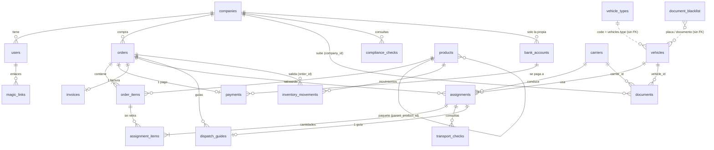

# 04 · Modelo de datos

Todas las tablas (salvo `order_counters`) incluyen las 5 columnas de auditoría de `AuditMixin`
(`created_at`, `updated_at`, `created_by_user_id`, `updated_by_user_id`, `deleted_by_user_id`) y no se repiten abajo.
Todos los `id` son `UUID` generados por Python (`uuid4`).

## 1. Diagrama entidad–relación

## 2. Tablas

### 2.1 Personas y empresas

#### `users` — [models/user.py](../Backend/app/models/user.py)
| Columna | Tipo | Notas |
|---|---|---|
| `document_id` | str, único | **Es el usuario de login** (no el email) |
| `full_name` | str | |
| `email` | str, único, opcional | |
| `hashed_password` | str | hash bcrypt |
| `role` | str | uno de: admin, cartera, logistica, operaciones, soporte, porteria, cliente_admin, cliente_operativo (texto libre, **sin validación en BD**) |
| `company_id` | FK companies, **obligatorio** | incluso para internos (pertenecen a la empresa propia) |
| `is_active` | bool | |

#### `companies` — [models/company.py](../Backend/app/models/company.py)
| Columna | Notas |
|---|---|
| `client_code` | único; `CLI-0001` (clientes) / `HAC-0001` (propia) |
| `legal_name`, `display_name` | razón social tal como en el RUT / nombre corto de UI |
| `document_type`, `document_number` | único en conjunto. Persona jurídica = siempre `NIT` |
| `company_type` | `own` (la Hacienda; **debe existir una sola**) o `client` |
| `business_sector` | `construccion` \| `agro` (obligatorio para clientes) |
| `person_type` | `natural` \| `juridica` |
| `address, phone, email, country, department, city` | datos operativos |
| `economic_activity_code / _description` | CIIU 4 dígitos |
| `fiscal_address / _phone / _email` | datos del RUT; si son null se asumen iguales a los operativos |
| `legal_rep_*` (name, document_type, document_number, email, city) | representante legal (obligatorio para jurídica) |
| `verification_status` | `draft` \| `pending` \| `approved` \| `rejected` |
| `rejection_type` / `rejection_reason` | `documents` (corregible) o `compliance` (definitivo) |
| `verified_at`, `verified_by_user_id` | quién aprobó/rechazó |
| `is_active`, `deactivation_reason`, `deactivated_at`, `deactivated_by_user_id` | desactivación |

#### `compliance_checks` — consultas en listas de una empresa
`company_id`, `subject` (`company` \| `legal_representative`), `check_key`, `has_findings`, `note`.
Único por (`company_id`, `subject`, `check_key`).

#### `magic_links` — enlace de acceso sin contraseña
`user_id`, `token` (único, 32 bytes url-safe), `status` (`pending|used|expired`), `expires_at` (48 h), `used_at`.

### 2.2 Catálogo e inventario

#### `products` — [models/product.py](../Backend/app/models/product.py)
`name`, `category`, `approx_weight_kg` (referencia), `price`, `unit` (kg, tonelada, unidad, m3, canasta, bulto),
`tax_rate` (0.19 por defecto), `is_active`.
**Paquetes:** `parent_product_id` + `units_per_pack` (deben venir juntos). Ej.: producto base "Manzana (unidad)" y paquete
"Caja x24" con `parent_product_id = manzana`, `units_per_pack = 24`. Un paquete no puede ser hijo de otro paquete.
El inventario solo existe en el producto base.

#### `inventory_movements` — kardex, **inmutable**
`product_id` (siempre un producto base), `order_id` (si vino de un despacho), `movement_type`
(`entrada` \| `salida` \| `ajuste`), `quantity` (entero; en ajuste puede ser negativo), `reason`,
`category` (solo ajustes: `damage` \| `count_difference` \| `other`).
Las `salida` las crea únicamente `register_guide_exit`. Índice por (`product_id`, `created_at`).

### 2.3 Pedido, pago y factura

#### `orders`
`order_number` (único, `PED-AAAA-NNNN`), `company_id`, `status`, `subtotal`, `tax`, `total`,
`cancelled_at`, `cancelled_by_user_id`, `cancellation_reason`. El "creado por" es `created_by_user_id`
(importante: define qué ve un `cliente_operativo`).

#### `order_items`
`order_id`, `product_id`, `quantity_m3` (**entero**; el nombre es un resto del dominio de áridos: hoy significa
"cantidad en la unidad del producto"), `unit_price`, `subtotal` (precio congelado).

#### `order_counters` (sin auditoría)
`year` (PK), `last_number`. Contador atómico anual para `PED-AAAA-NNNN`.

#### `payments` (máx. 1 por pedido)
`order_id` (único), `bank_account_id`, `proforma_number` (único, `PRO-…`), `status`
(`pending|confirmed|failed|cancelled`), `amount`, `pdf_url`, `receipt_url`, `receipt_uploaded_at`, `confirmed_at`, `rejection_reason`.

#### `bank_accounts`
`company_id` (solo la empresa propia), `bank_name`, `account_type` (`ahorros|corriente`), `account_number`,
`account_holder_name`, `account_holder_document_type/_number`, `agreement_number`, `is_active`.
No puede haber dos cuentas **activas** con el mismo banco y número.

#### `invoices` (máx. 1 por pedido)
`order_id` (único), `status` (`pending|issued`), copia de `subtotal/tax/total`, `invoice_number` (único),
`cufe`, `issued_at`, `signed_at`, `signature`, `provider` (`simulado`), `pdf_url`, `xml_url` (sin uso).
**Todos los valores DIAN son `PRUEBA-…`**; el PDF dice "Representación gráfica de SIMULACIÓN" (la marca de agua diagonal existe en el código pero está desactivada).

### 2.4 Transporte y despacho

#### `assignments` — un **retiro**
| Columna | Notas |
|---|---|
| `order_id`, `sequence` | único en conjunto: retiro 1, 2, 3… del pedido |
| `vehicle_id`, `carrier_id` | FK |
| `validation_status` | `pending` \| `approved` \| `rejected` |
| `rejection_reason`, `validated_at`, `validated_by_user_id` | decisión de Logística |
| `background_check_verified` | true si se aprobó (consultas registradas) |
| `review_pending` | hay que repetir consultas tras un cambio de transporte ya aprobado |
| `cancelled_at`, `cancellation_reason` | retiro anulado: libera sus cantidades |
| `assigned_at` | fecha de creación del retiro |

#### `assignment_items` — cantidades de un retiro
`assignment_id`, `order_item_id`, `quantity` (> 0, restricción CHECK). Único por (`assignment_id`, `order_item_id`).

#### `vehicles`
`type` (código de `vehicle_types.code`, sin FK), `plate` (única, normalizada), `owner_name`, `owner_document_type`,
`owner_document_id`, `owner_phone`. Se reutiliza por placa entre pedidos.

#### `carriers`
`full_name`, `document_type`, `document_id` (único en conjunto), `phone`, `address`, `is_active`. Se reutiliza por documento.

#### `vehicle_types`
`code` (único, derivado del nombre, ≤ 20 caracteres), `name`, `capacity_kg`, `is_active`. Administrable desde la interfaz.

#### `documents` — documentos de **empresa, vehículo o transportador**
Exactamente uno de `company_id` / `vehicle_id` / `carrier_id` está lleno (lo exige `create_document`, no la BD).
`document_type` (`rut`, `soat`, `licencia_conduccion`…), `document_url`, `status` (`pending|approved|rejected`),
`rejection_reason`, `expires_at` (solo SOAT y licencia).

#### `transport_checks` — consultas hechas a un retiro
`assignment_id`, `subject` (`vehicle|owner|carrier`), `check_key` (`simit|listas_vinculantes|antecedentes_judiciales`),
`has_findings`, `note`, `subject_ref` (placa o "TIPO número"; sirve para detectar que el transporte cambió mientras se verificaba).
Único por (`assignment_id`, `subject`, `check_key`).

#### `document_blacklist` — lista negra
`document_type` (incluye el valor especial **`PLACA`**), `document_number`, `reason`, `is_active` (des-vetar sin borrar historial).
Único por (`document_type`, `document_number`). Se consulta contra la placa, el documento del dueño y el del transportador.

#### `dispatch_guides` — una por retiro
`order_id`, `assignment_id` (único), `token` (único, secreto del QR), `status` (`pending|in_plant|used`),
`origin`, `destination`, `cargo_detail` (texto con lo que se lleva), `balance_detail` (saldo pendiente),
`qr_image_url`, `entered_at`, `used_at`.

## 3. Migraciones: hechos útiles

- Hay **58** migraciones; el *head* actual es `caffaa585f24` (`partial_dispatches`).
- Hay dos migraciones con nombre parecido (`8919aa1ccd7e_crear_tabla_magic_links` y `b361192188f2_create_tabla_magic_link`):
  pertenecen a la cadena; no las borres sin revisar `down_revision`.
- `4ace3a04ccb1_crear_tabla_materials` + `6de909b25201_renombrar_materials_a_products` es el ejemplo real de cómo se renombra con `rename_table`.
- Para ver la versión de la base: `alembic current`. Para ver la del código: `alembic heads`. Deben coincidir.
